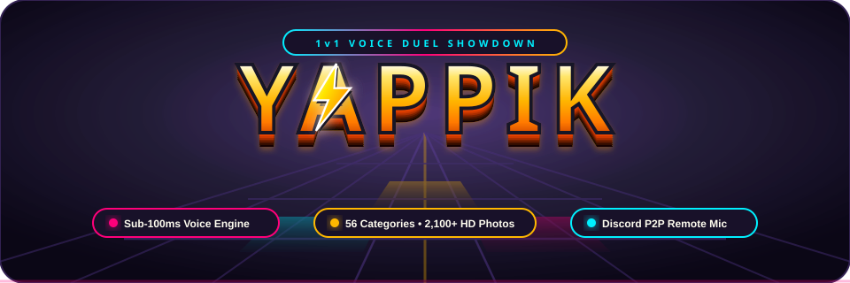

<p align="center">
  
</p>

# Yappik 📸⚡

<p align="center">
  <a href="https://albertorosati.github.io/yappik/">
    
  </a>
  
  
  
  
</p>

> **A fast-paced, voice-driven photo guessing duel.**  
> See the photo, shout the answer before your clock runs dry.

Play face-to-face on a shared device, practice solo against the clock, or stream on Discord while your friend buzzes in from their phone via P2P WebRTC.

👉 **Play Live**: [https://albertorosati.github.io/yappik/](https://albertorosati.github.io/yappik/)

---

## ⚡ Key Features

- 🗣️ **Real-Time Speech Recognition (Say What You See)**
  - Continuous ultra-low-latency voice stream parsing (<100ms).
  - Smart phonetic matching with Damerau-Levenshtein fuzzy tolerance, plural/singular leniency, accent stripping, multilingual alias expansion, and automatic digit-to-word conversion.
  - Instant voice pass command (*"Pass!"* / *"Passo!"*) with a 3-second penalty clock and a 1.4s frozen-clock answer reveal sticker.

- ⏱️ **Chess-Clock Style Sudden Death Timer**
  - Your clock only ticks when it's your turn.
  - Land a correct answer and your clock freezes instantly while your opponent's clock starts running with a fresh photo.
  - The first player to run out of time loses the round!

- 🎨 **Chunky, Playful Neo-Brutalist Cartoon UI**
  - High-contrast, tactile design system with thick 3px ink outlines (`#14121F`), hard offset shadows (`4px 4px 0 #14121F`), and flat saturated fills.
  - Dynamic 96px checkerboard stage that shifts color to follow the active player with a snappy turn wave.
  - Wordmark spelled with tilted square letter tiles and bouncy character avatars.

- 👥 **Versatile Game Modes**
  - **1v1 Local Duel**: Two players face off on a single screen with shared microphone.
  - **Solo Practice (1P)**: Race the clock to identify as many photos as possible, beat personal bests, and earn streak medals.
  - **Party Tournament (3–8P)**: Multi-player bracket with live standings, podium crowns, and custom challenger picking.
  - **Discord Screen Share + Remote Mic**: Stream the game on Discord while Player 2 connects their phone as a wireless buzzer via WebRTC.

- 📸 **56 Decks & 2,100+ Curated HD Photos**
  - Curated trivia decks spanning Movies & TV, Pop Music, Gaming, Sports, Anime, Nature, Food, World Landmarks, and Internet Memes.
  - Full-screen Category Gallery with theme filtering, search, and 3-card peek fan-out animations.

- 🔊 **Synthesized Procedural Audio**
  - 100% copyright-free Web Audio synthesizer (tension beeps, urgency ticks, victory fanfare, starburst chimes) + native speech synthesis announcements.

---

## 🎮 How to Play

1. **Configure Match**: Select points to win (3, 5, 7, or Free play) and turn duration (30s, 45s, 60s).
2. **Draft a Category**: Players take turns choosing 1 of 4 randomized category cards (or explore the full gallery).
3. **Voice Duel**:
   - The photo appears and your clock counts down.
   - **Shout the answer!** When recognized, your turn ends immediately and the clock switches to your rival.
   - Stuck? Shout **"Pass"** (or hit `Space`) to reveal the correct answer with a 3-second deduction.
   - First clock to hit zero loses!

### Keyboard Shortcuts
| Key | Action |
| :--- | :--- |
| `Space` | Pass / Skip photo (-3s penalty & 1.4s answer reveal) |
| `Enter` | Manual judge override (marks as correct) |
| `P` | Pause / Resume timer |
| `Esc` | Close modals / dialogs |

---

## 🚀 Setup & Run (Local Development)

### Prerequisites
- [Node.js](https://nodejs.org/) (version 18, 20, or 24)
- A modern web browser with Speech Recognition support (Google Chrome, Edge, Safari, or Chromium-based browsers)
- A working microphone (grant microphone permissions when prompted)

### Step-by-Step Instructions

1. **Clone the repository:**
   ```bash
   git clone https://github.com/albertorosati/yappik.git
   cd yappik
   ```

2. **Install dependencies:**
   ```bash
   npm install
   ```

3. **Start local development server:**
   ```bash
   npm run dev
   ```
   Open your browser at `http://localhost:5173`. Make sure to **allow microphone access** when requested.

4. **Run unit tests:**
   ```bash
   npm test
   ```

5. **Build for production:**
   ```bash
   npm run build
   npm run preview
   ```

---

## 📂 Project Structure

```
yappik/
├── public/
│   ├── categories/            # 56 modular category JSON files + index.json
│   ├── config/                # Runtime game configuration JSON
│   ├── manifest.webmanifest   # Progressive Web App manifest
│   └── banner.svg             # Project banner art
├── src/
│   ├── components/            # React neo-brutalist UI screens & widgets
│   │   ├── LobbyScreen.tsx    # Home & setup screen
│   │   ├── CategoryDraftScreen.tsx # 4-card draft & party challenger pick
│   │   ├── DuelArenaScreen.tsx# 1v1 voice duel chess clock arena
│   │   ├── SoloTrainingScreen.tsx # Solo practice mode
│   │   ├── CategoryGalleryModal.tsx # Full category gallery with 3-card peek
│   │   ├── TheFloorLogo.tsx   # "YAPPIK" tile wordmark component
│   │   ├── TheFloorBackground.tsx # Dynamic checkerboard floor stage
│   │   └── VictoryScreen.tsx  # Champion screen & podium recap
│   ├── engine/                # Speech recognition, WebRTC sync & audio synth
│   ├── services/              # i18n, CategoryRepository, PWA & scoring
│   ├── types/                 # TypeScript interfaces and game models
│   ├── App.tsx                # Main screen router & state coordinator
│   └── main.tsx               # Application entry point
├── .github/workflows/         # Automated GitHub Pages CI/CD workflow
└── package.json
```

---

## 🌐 Deployment

Continuous deployment is preconfigured via GitHub Actions:
- Workflow file: `.github/workflows/deploy.yml`
- Production target: **[https://albertorosati.github.io/yappik/](https://albertorosati.github.io/yappik/)**

---

## 📄 License

MIT License. Crafted with ❤️ for party games, quick wits, and voice duels.
